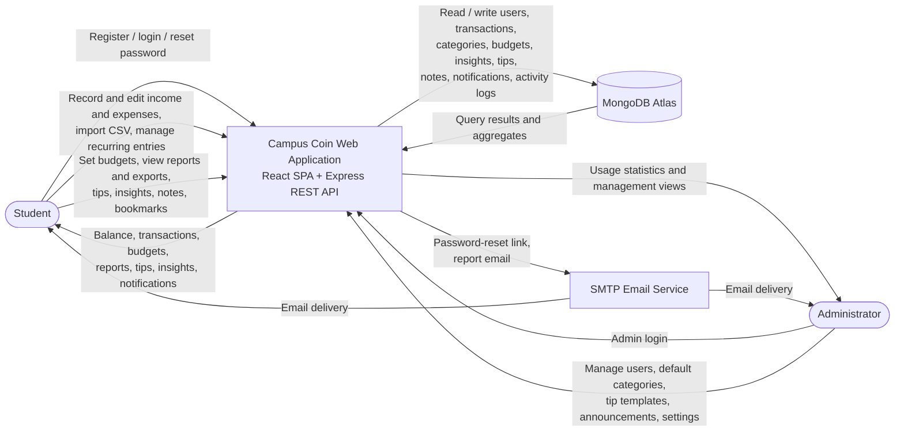
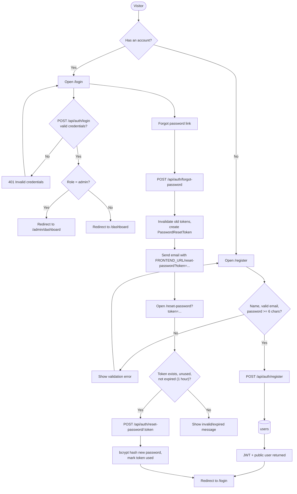
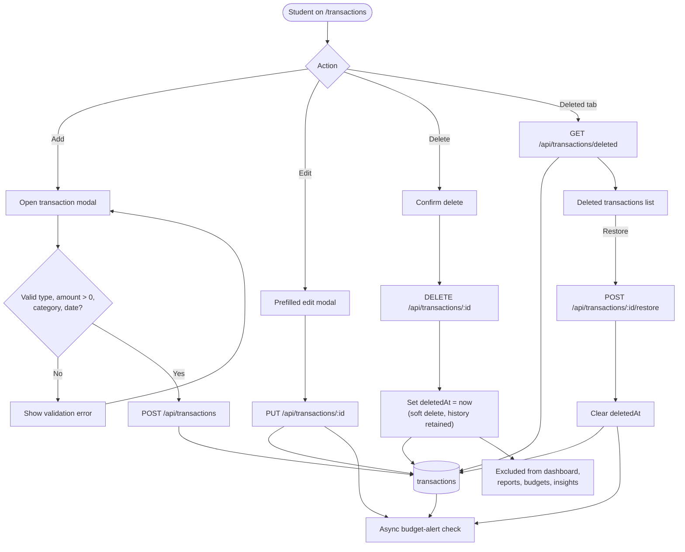
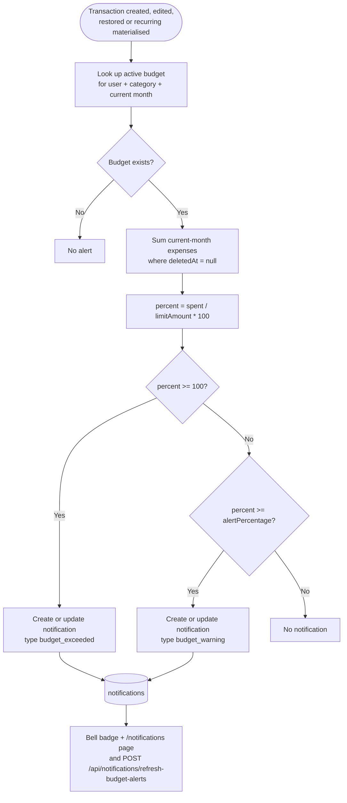
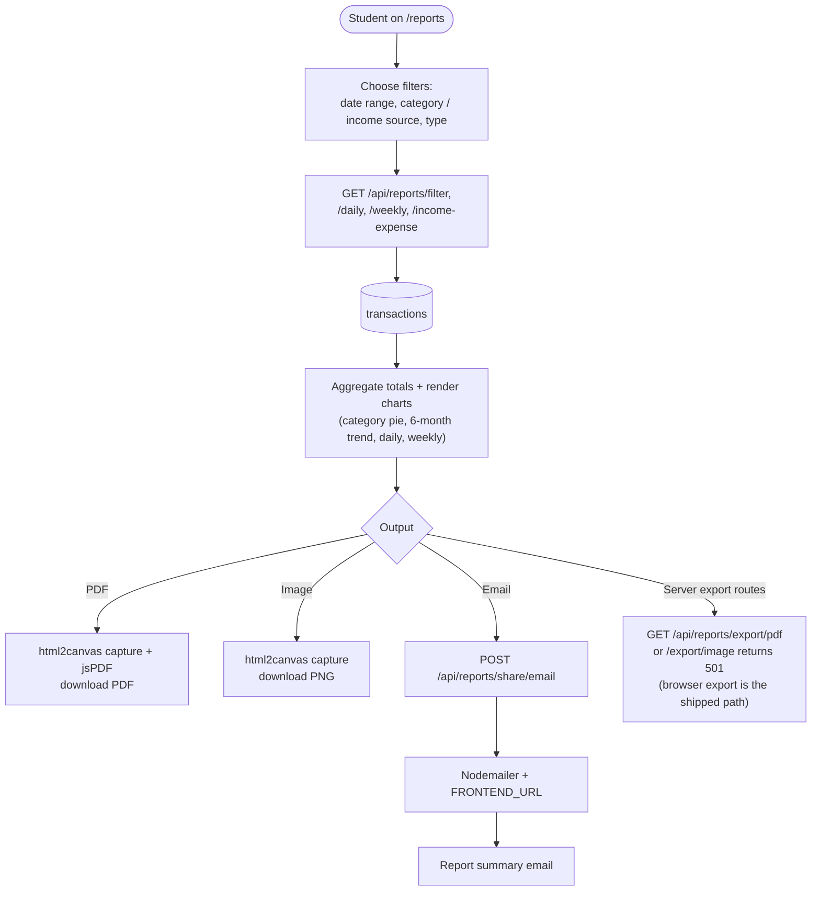

# Campus Coin — Data Flow Diagrams & Flowcharts

This document contains the SRS §1.9 design diagrams for Campus Coin:

1. Level-0 context diagram
2. Level-1 process decomposition
3. Flowcharts: registration/login/password reset, transaction lifecycle (including soft delete/restore), budget alert, report generation

All diagrams are written in [Mermaid](https://mermaid.js.org/) and render on GitHub/GitLab or any Mermaid-compatible Markdown viewer. They describe the implementation in this repository (`backend/api/index.js`, `backend/routes/*`, `backend/controllers/*`, `frontend/src/**`).

> **STUDENT TO WRITE:** in the final report, add a short explanation of each diagram in your own words (what the student/admin does, which process handles it, which data store is touched) — do not just paste the diagrams.

---

## 1. Level-0 context diagram

External entities: **Student**, **Administrator**, **SMTP Email Service** (for reset/report emails). The system under design is the Campus Coin web application (React SPA + Express API) with MongoDB Atlas as the data store.

---

## 2. Level-1 process decomposition

The API is split into six logical process groups. Data stores D1–D7 are the MongoDB collections (see [ERD.md](ERD.md)).

```mermaid
flowchart TB
    STUD(["Student"])
    ADM(["Administrator"])
    SMTP["SMTP Email Service"]

    subgraph P1["P1 Authentication and Session"]
        P11["Register / login / logout"]
        P12["JWT session check (protect middleware)"]
        P13["Forgot / reset password token"]
    end

    subgraph P2["P2 Transactions, CSV and Recurring"]
        P21["Add / edit / delete transaction"]
        P22["Soft delete, deleted list, restore"]
        P23["CSV preview + import with AI suggestions"]
        P24["Recurring CRUD + due-occurrence sweep"]
    end

    subgraph P3["P3 Budgets and Alerts"]
        P31["Create / edit / delete budget"]
        P32["Compute spend vs limit"]
        P33["Create budget warning / exceeded notification"]
    end

    subgraph P4["P4 Reports, Export and Email"]
        P41["Category / income-expense / daily / weekly / filtered reports"]
        P42["Browser PDF and PNG export"]
        P43["Email report summary"]
    end

    subgraph P5["P5 Tips and AI Insights"]
        P51["Generate personalised saving tips"]
        P52["Generate monthly narrative insight + flags"]
        P53["AI category suggestion and correction feedback"]
    end

    subgraph P6["P6 Admin Management"]
        P61["User view / disable / reset"]
        P62["Default categories, tip templates, announcements"]
        P63["Usage statistics"]
    end

    D1[("D1 users")]
    D2[("D2 categories")]
    D3[("D3 transactions")]
    D4[("D4 budgets")]
    D5[("D5 insights + tips + notes + bookmarks")]
    D6[("D6 notifications + activity logs")]
    D7[("D7 recurring + import batches + AI feedback")]
    D8[("D8 announcements + templates + settings")]

    STUD --> P11
    STUD --> P21
    STUD --> P31
    STUD --> P41
    STUD --> P52
    ADM --> P13
    ADM --> P6

    P11 --> D1
    P12 --> D1
    P13 --> D1
    P13 --> SMTP

    P21 --> D3
    P22 --> D3
    P23 --> D7
    P23 --> D3
    P24 --> D7
    P24 --> D3

    P31 --> D4
    P32 --> D3
    P32 --> D4
    P33 --> D6

    P41 --> D3
    P41 --> D2
    P42 --> STUD
    P43 --> SMTP

    P51 --> D5
    P51 --> D3
    P51 --> D4
    P52 --> D5
    P52 --> D3
    P53 --> D7
    P53 --> D2

    P61 --> D1
    P62 --> D2
    P62 --> D8
    P62 --> D6
    P63 --> D1
    P63 --> D3

    P52 --> D6
    P33 --> D6
```

---

## 3. Flowcharts

### 3.1 Registration, login and password reset

### 3.2 Transaction lifecycle (add, edit, delete, soft delete, restore)

### 3.3 Budget alert

### 3.4 Report generation, export and sharing

---

## 4. Reading the diagrams in the report

| Diagram | SRS deliverable | Where the behaviour lives |
|---|---|---|
| Level-0 | Context / scope | `backend/api/index.js` route mounting, `frontend/src/App.jsx` |
| Level-1 | Process decomposition | `backend/routes/*`, `backend/controllers/*`, `backend/services/*` |
| 3.1 Auth | Flowchart for registration/login/reset | `controllers/auth.controller.js`, `pages/Auth/*` |
| 3.2 Transactions | Flowchart for logging + history | `controllers/transaction.controller.js`, `pages/Transactions/Transactions.jsx` |
| 3.3 Budget alert | Flowchart for alerts | `services/budgetAlert.service.js`, `controllers/budget.controller.js` |
| 3.4 Reports | Flowchart for report generation | `controllers/report.controller.js`, `pages/Reports/Reports.jsx` |

> **STUDENT TO WRITE:** for the academic report, draw/export these diagrams (Mermaid editor → PNG/SVG or draw in draw.io) and write a paragraph per diagram describing the flow and design decisions. The report must not contain source code (SRS §1.9).
