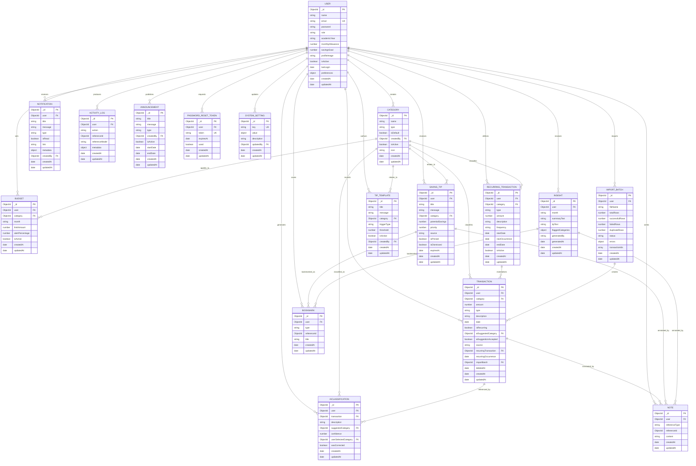

# Campus Coin — Database Design (ERD)

**Database:** MongoDB Atlas (database `test` in the current hosted deployment)
**ODM:** Mongoose 9
**Models:** 17 Mongoose models in `backend/models/` → 17 collections
**Why MongoDB:** the SRS §1.8 explicitly lists MongoDB/JSON as an acceptable database, alongside MySQL/SQL Server. The SRS §1.2 architecture note says “relational database”, but §1.8 takes precedence for the implementation options; this document therefore describes the document-oriented design that was built.

> **STUDENT TO WRITE:** in the final academic report, add a short paragraph explaining *why* a document database suits this app (flexible embedded `flaggedCategories`, JSON-like transactions, Atlas hosting), and acknowledge the SRS §1.2 wording.

---

## 1. Entity–relationship diagram

**Cardinality summary:** one `USER` owns zero-to-many of every user-scoped collection; one `CATEGORY` is referenced by many transactions/budgets/recurring entries; one `RECURRING_TRANSACTION` materialises zero-to-many `TRANSACTION` rows; one `IMPORT_BATCH` creates zero-to-many transactions. `BOOKMARK`/`NOTE` reference tips/insights/transactions **polymorphically** via `referenceId` (application-enforced, no database FK).

---

## 2. Collection reference

Mongoose maps each model to a pluralised collection name; all include `createdAt` / `updatedAt` (schema `timestamps: true`).

| # | Model (file) | Collection | Purpose | Key fields / constraints |
|---|---|---|---|---|
| 1 | `User.js` | `users` | Students and administrators | `email` unique + lowercase; `password` bcrypt hash; `role` enum student/admin; `academicYear`, `monthlyAllowance`, `savingsGoal`, `profileImage`, `isActive`, `lastLogin`; embedded `preferences { darkMode, fontSize }` |
| 2 | `Category.js` | `categories` | Personal + system default categories | `name`, `type` enum income/expense, `isDefault` (system categories, `createdBy: null`), `createdBy` (user's own), `isActive`, `icon` |
| 3 | `Transaction.js` | `transactions` | Income / expense records | `user` + `category` required; `amount ≥ 0`; `type` enum; `description`; `date`; `isRecurring`; `aiSuggestedCategory`; `aiSuggestionAccepted`; `source` enum manual/csv/ai/recurring; `recurringTransaction` + `recurringOccurrence` (idempotent recurring link); `importBatch`; **`deletedAt`** for soft delete/history; indexes `{user,date}`, `{user,deletedAt,date}`, `{user,recurringTransaction,recurringOccurrence}` |
| 4 | `Budget.js` | `budgets` | Monthly per-category budget | `user` + `category` + `month` (`YYYY-MM`) required; `limitAmount ≥ 0`; `alertPercentage` 1–100 (default 80); `isActive` |
| 5 | `RecurringTransaction.js` | `recurringtransactions` | Recurring rules | `user` + `category` required; `type`; `amount`; `frequency` weekly/monthly/yearly; `startDate`, `nextOccurrence`; `endDate`; `isActive` |
| 6 | `Insight.js` | `insights` | AI-style monthly narrative | `user` + `month`; `summaryText`; `tipText`; embedded `flaggedCategories[] { category, categoryName, growthPercentage, message }`; `generatedBy` ai/system; `generatedAt` |
| 7 | `SavingTip.js` | `savingtips` | Personalised saving tips | `user`; `title`, `message`; optional `category`; `potentialSavings`; `priority`; `source` system/ai/template; `isPinned`; `isDismissed`; `expiresAt` |
| 8 | `Notification.js` | `notifications` | In-app notifications | `user`; `title`, `message`; `type` enum budget_warning/budget_exceeded/saving_tip/insight/announcement/system; `isRead`; `link`; `metadata` (Mixed); `createdBy` |
| 9 | `Bookmark.js` | `bookmarks` | Saved tips/insights | `user`; `type` enum saving_tip/insight; `referenceId`; `title` |
| 10 | `Note.js` | `notes` | Notes attached to a record | `user`; `referenceType` enum transaction/saving_tip/insight; `referenceId`; `content` |
| 11 | `AIClassification.js` | `aiclassifications` | AI suggestion + correction learning | `user`; optional `transaction`; `description`; `suggestedCategory` required; `confidence` 0–1; `userSelectedCategory`; `wasCorrected` |
| 12 | `ImportBatch.js` | `importbatches` | CSV import tracking | `user`; `fileName`; `totalRows`, `successfulRows`, `failedRows`, `duplicateRows`; `status` processing/completed/failed; `errors[] {row,message}`; `transactionIds[]` |
| 13 | `ActivityLog.js` | `activitylogs` | Intelligence/audit events | `user`; `action` enum view/create/edit/delete transaction, view_report, create/edit budget, login, logout; `referenceId`; `referenceModel`; `metadata` |
| 14 | `Announcement.js` | `announcements` | Admin broadcast messages | `title`, `message`; `type`; `createdBy`; `isActive`; `startDate`, `endDate` |
| 15 | `TipTemplate.js` | `tiptemplates` | Admin system-wide tip templates | `title`, `message`; optional `category`; `triggerType` enum high_spending/budget_near_limit/budget_exceeded/low_savings/general; `threshold`; `isActive`; `createdBy` |
| 16 | `PasswordResetToken.js` | `passwordresettokens` | Tokenised password reset | `user`; `token` unique; `expiresAt` (1 hour); `used` |
| 17 | `SystemSetting.js` | `systemsettings` | Admin key/value settings | `key` unique; `value` Mixed; `description`; `updatedBy` |

> The SRS §1.8 examples use numeric `INT` keys; Mongoose uses `ObjectId` (`_id`) primary keys and `ObjectId` references. That is a valid design choice (the SRS says its example schema is indicative and may be changed).

---

## 3. Relationship notes

1. **Owner isolation.** Every student-owned collection (`transactions`, `categories` created by students, `budgets`, `recurringtransactions`, `insights`, `savingtips`, `notifications`, `bookmarks`, `notes`, `aiclassifications`, `importbatches`, `activitylogs`, `passwordresettokens`) stores a `user` reference; all controllers filter by the authenticated user, so students never read another student's data.
2. **Default vs personal categories.** System defaults have `isDefault: true` and `createdBy: null` (seeded by `seedCategories.js`). Student categories have `createdBy: <user>`; edit/delete requires ownership and `isDefault === false`.
3. **Transaction history.** `deletedAt` implements soft delete: normal reads filter `deletedAt: null`; the Deleted view reads `deletedAt != null`; restore sets it back to `null`. This satisfies “edits and deletes while retaining the full history”.
4. **Recurring materialisation.** `recurringTransaction` + `recurringOccurrence` on a transaction make generation idempotent — the recurring service checks this pair before inserting, so repeated `/api/recurring/process` or dashboard calls never duplicate an occurrence.
5. **CSV imports.** `ImportBatch.transactionIds` and `Transaction.importBatch` link a batch to the rows it created; `aiSuggestedCategory` records the suggestion used during the CSV review flow.
6. **AI learning.** `AIClassification` stores each suggestion (`suggestedCategory`, `confidence`) and the student's correction (`userSelectedCategory`, `wasCorrected`); the categoriser reads a user's historical corrections before falling back to keyword rules and transaction history.
7. **Tip templates → tips.** Active `TipTemplate` documents are rendered by the tips engine into `SavingTip` rows (`source: "template"`); tips can be pinned/dismissed per student.
8. **Insight flags.** `flaggedCategories` is an embedded array (no separate collection) with an optional `category` reference plus `categoryName` so old insights still render if a category is removed.
9. **Polymorphic references.** `Bookmark.referenceId` and `Note.referenceId` point to either a tip, insight or transaction depending on `type`/`referenceType`; referential integrity is enforced in controllers (ownership checks), not by MongoDB.
10. **Announcements → notifications.** `Announcement` has no notification FK; when created, the controller inserts one `Notification` (`type: "announcement"`) per active student. The relationship is therefore application-level (shown as a note rather than an ERD edge).
11. **Token lifecycle.** `PasswordResetToken` rows are single-use (`used`) and expire after 1 hour; a new request invalidates the user's previous unused tokens. Admin “reset user password” reuses the same token flow.

---

## 4. Schema export / submission note

The SRS asks for SQL scripts or schema files. Because the database is MongoDB, the equivalent “schema files” are the Mongoose model definitions in `backend/models/*.js`. For the submission zip:

- include this ERD document + `backend/models/` as the schema definition (or export each model’s `schema.paths` to JSON with a small one-off script),
- state in the report/ReadMe: “MongoDB was used (allowed by SRS §1.8); collection definitions are the Mongoose schemas in `backend/models/`; no `.sql` script is applicable.”
