# Campus Coin — Sitemap

Two views of the application map are provided:

1. **In-app sitemap** — the home page contains a visible `#sitemap` section (linked from the navbar and footer) that lists Public Pages, Student Portal and Admin Panel links. This is the SRS §1.9 deliverable “add a sitemap to the home page”.
2. **This document** — the complete route map, matching `frontend/src/App.jsx`, with access rules.

---

## 1. Route sitemap

```mermaid
flowchart TD
    ROOT(["Campus Coin<br/>/"])

    ROOT --> PUBLIC["Public pages"]
    PUBLIC --> HOME["/ — Home (hero, features,<br/>Explore grid, Sitemap section, footer)"]
    PUBLIC --> LOGIN["/login — Student login"]
    PUBLIC --> REGISTER["/register — Student registration"]
    PUBLIC --> FORGOT["/forgot-password — Request reset link"]
    PUBLIC --> RESET["/reset-password — Set new password<br/>(token from email)"]
    PUBLIC --> ADMINLOGIN["/admin/login — Administrator login"]

    ROOT --> STUDENT["Student portal<br/>(JWT required, role = student)"]
    STUDENT --> DASH["/dashboard — Balance, budget vs actual,<br/>spending overview, top category, tips"]
    STUDENT --> TXN["/transactions — Add / edit, filters, search,<br/>CSV import with AI review, recurring panel,<br/>deleted + restore"]
    STUDENT --> BUDGETS["/budgets — Monthly budgets,<br/>progress bars, status"]
    STUDENT --> REPORTS["/reports — Category, 6-month trend,<br/>daily + weekly charts, filters,<br/>PDF/PNG export, email share"]
    STUDENT --> INSIGHTS["/insights — Generate and review<br/>monthly AI-style insights, flags, save/delete"]
    STUDENT --> TIPS["/saving-tips — Ranked tips,<br/>pin / dismiss / bookmark"]
    STUDENT --> CATEGORIES["/categories — Personal categories<br/>(income / expense)"]
    STUDENT --> NOTES["/notes — Notes attached to<br/>transactions, tips or insights"]
    STUDENT --> PROFILE["/profile — Personal details,<br/>dark mode, font size"]
    STUDENT --> NOTIFICATIONS["/notifications — Budget alerts,<br/>announcements, system messages"]

    ROOT --> ADMIN["Admin panel<br/>(JWT required, role = admin)"]
    ADMIN --> ADMINDASH["/admin/dashboard — System overview"]
    ADMIN --> USERS["/admin/users — View, disable/enable,<br/>reset password"]
    ADMIN --> ADM_CAT["/admin/categories — Default categories<br/>add/edit/remove/toggle"]
    ADMIN --> TEMPLATES["/admin/templates — Tip / announcement<br/>templates add/edit/remove/toggle"]
    ADMIN --> ANNOUNCE["/admin/announcements — Broadcast<br/>messages to students (creates notifications)"]
    ADMIN --> STATS["/admin/statistics — Active users,<br/>transactions, most-used categories,<br/>monthly usage chart"]
    ADMIN --> SETTINGS["/admin/settings — Key/value system settings,<br/>admin dark mode"]

    ROOT --> ANY["Catch-all * — redirect to /"]
    LOGIN -.->|"success (student)"| DASH
    ADMINLOGIN -.->|"success (admin)"| ADMINDASH
    FORGOT -.->|"email link"| RESET
```

---

## 2. Route table

| Path | Page component | Access | Layout | SRS area |
|---|---|---|---|---|
| `/` | `pages/Home/Home.jsx` | Public | Navbar + Footer | Landing, sitemap (§1.9) |
| `/login` | `pages/Auth/Login.jsx` | Public | Navbar | Auth |
| `/register` | `pages/Auth/Register.jsx` | Public | Navbar | Auth |
| `/forgot-password` | `pages/Auth/ForgotPassword.jsx` | Public | Card layout | Password recovery |
| `/reset-password` | `pages/Auth/ResetPassword.jsx` | Public (token) | Card layout | Password recovery |
| `/admin/login` | `pages/admin/AdminLogin/AdminLogin.jsx` | Public | Card layout | Separate admin access |
| `/dashboard` | `pages/Dashboard/Dashboard.jsx` | Student JWT | `DashboardLayout` | Dashboard |
| `/transactions` | `pages/Transactions/Transactions.jsx` | Student JWT | `DashboardLayout` | Logging, CSV, recurring, history |
| `/budgets` | `pages/Budgets/Budgets.jsx` | Student JWT | `DashboardLayout` | Budget goals |
| `/reports` | `pages/Reports/Reports.jsx` | Student JWT | `DashboardLayout` | Monthly reports |
| `/insights` | `pages/Insights/Insights.jsx` | Student JWT | `DashboardLayout` | AI-style insights |
| `/saving-tips` | `pages/SavingTips/SavingTips.jsx` | Student JWT | `DashboardLayout` | Saving tips / bookmarks |
| `/categories` | `pages/Categories/Categories.jsx` | Student JWT | `DashboardLayout` | Category management |
| `/notes` | `pages/Notes/Notes.jsx` | Student JWT | `DashboardLayout` | Notes |
| `/profile` | `pages/Profile/Profile.jsx` | Student JWT | `DashboardLayout` | Profile, accessibility |
| `/notifications` | `pages/Notifications/Notifications.jsx` | Student JWT | `DashboardLayout` | In-app notifications |
| `/admin/dashboard` | `pages/admin/AdminDashboard/AdminDashboard.jsx` | Admin JWT | `AdminLayout` | Admin stats |
| `/admin/users` | `pages/admin/Users/Users.jsx` | Admin JWT | `AdminLayout` | User management |
| `/admin/categories` | `pages/admin/AdminCategories/AdminCategories.jsx` | Admin JWT | `AdminLayout` | Default categories |
| `/admin/templates` | `pages/admin/Templates/Templates.jsx` | Admin JWT | `AdminLayout` | Tip templates |
| `/admin/announcements` | `pages/admin/Announcements/Announcements.jsx` | Admin JWT | `AdminLayout` | Announcements |
| `/admin/statistics` | `pages/admin/Statistics/Statistics.jsx` | Admin JWT | `AdminLayout` | Usage statistics |
| `/admin/settings` | `pages/admin/Settings/Settings.jsx` | Admin JWT | `AdminLayout` | System settings |
| `*` | redirect → `/` | Public | — | 404 fallback |

**Access control:** `frontend/src/components/ProtectedRoute.jsx` redirects unauthenticated users to `/login` (student routes) or `/admin/login` (admin routes), and cross-role access to the correct dashboard. The backend independently enforces JWT + role on every `/api/*` route (`backend/middleware/auth.middleware.js`), so the frontend guard is UX only, not security.

> **STUDENT TO WRITE:** include a screenshot of the home-page sitemap section in the report and describe the user journey (public → student portal → admin panel) in your own words.
